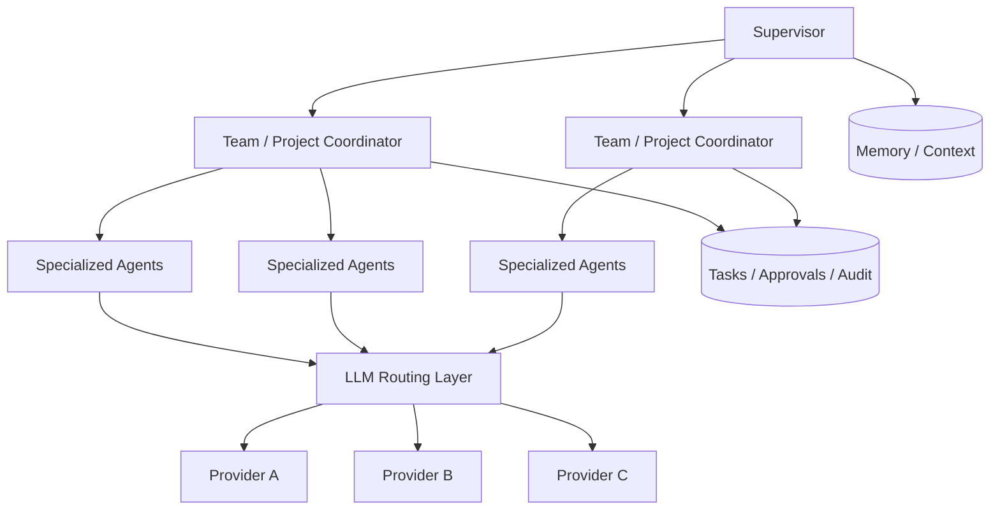

# AI Company - Sanitized Engineering Overview

> **Status:** Active private system  
> **Source repository/workspace:** Private  
> **Public purpose:** Demonstrate multi-agent and AI-infrastructure capability without exposing reusable internal operating logic

## System scope
AI Company is a multi-agent AI orchestration environment designed to coordinate several product and business workstreams inside one structured operating system.

The private system contains reusable internal workflows and operating patterns. Those details are intentionally not published because they represent a meaningful part of the system's value.

## Technology / concepts used
- Ruflo orchestration
- Hierarchical-mesh agent topology
- LiteLLM provider abstraction/routing
- Multi-provider LLM strategy
- Hybrid memory
- HNSW / vector-search concepts
- Codex CLI assisted implementation
- Persistent task / approval / audit / usage concepts
- Isolated project/customer workspace design

## High-level architecture

The public diagram intentionally excludes the actual prompts, agent instructions, business processes, internal tool wiring, memory schema, routing rules, and reusable operational logic.

## Engineering evidence
The project demonstrates that I can:
- structure an agent-based system rather than use isolated prompts;
- reason about agent responsibilities and context isolation;
- integrate multiple LLM providers behind a routing layer;
- design around persistent memory, task state, approvals, and auditability;
- use AI coding agents as part of an engineering workflow while retaining human validation and system-level decision making;
- separate product/business contexts to reduce cross-contamination and improve maintainability.

## What I can show in an interview
- live architecture walkthrough;
- sanitized configuration excerpts;
- selected terminal/system health output;
- agent/team topology explanation;
- a small safe demo task executed through the orchestration layer;
- discussion of provider routing, context separation, and failure handling.

## What is intentionally not public
- internal prompts / agent instructions;
- complete configuration;
- secrets and API keys;
- reusable business workflows;
- customer/project-specific context;
- source code or scripts that would allow cloning the operating system.
