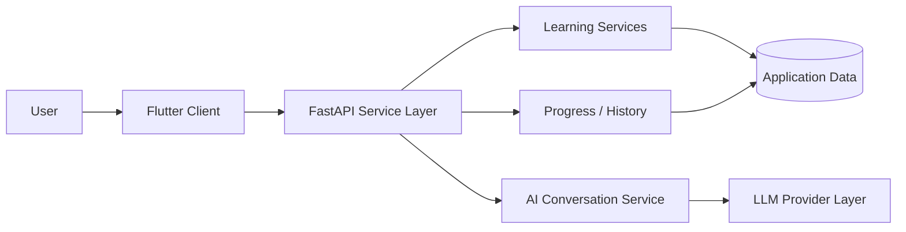

# LearnAva / Zabanyar - Sanitized Engineering Overview

> **Status:** Active private product  
> **Source repository:** Private  
> **Public purpose:** Demonstrate engineering capability without exposing product IP

## Product scope
LearnAva is a Persian-first German-learning and exam-preparation product. The private implementation includes language-learning workflows, AI-assisted conversation, learning progress/history, and exam-oriented practice.

The public description deliberately omits the product's proprietary learning logic, prompts, content structure, user flows, ranking/scoring decisions, and implementation details that could make the product easy to reproduce.

## Technology surface
- Flutter frontend
- Python / FastAPI backend
- REST / JSON APIs
- Docker Compose development environment
- Git / GitHub workflows
- Testing and debugging
- LLM integration for selected AI-assisted experiences

## High-level architecture

This diagram is intentionally high level. Internal service boundaries, prompts, domain models, algorithms, data structures, and product-specific workflows are not published.

## Engineering evidence
The project demonstrates that I can:
- work across frontend and backend boundaries;
- define implementation tasks and validation criteria;
- integrate external AI services into a real product workflow;
- use containers and Git as part of day-to-day delivery;
- debug and review AI-assisted implementation rather than accepting generated code blindly;
- keep a multi-part product moving through iterative milestones.

## What I can show in an interview
- selected UI flows via screen sharing;
- repository structure at a non-sensitive level;
- one or two sanitized code excerpts;
- how I use AI coding agents and review their output;
- debugging / testing examples;
- architecture decisions and trade-offs.

## What is intentionally not public
- production source code;
- proprietary prompts;
- database schema details;
- private content/data;
- product-specific algorithms and business logic;
- secrets, credentials, provider configuration, or deployment details.
